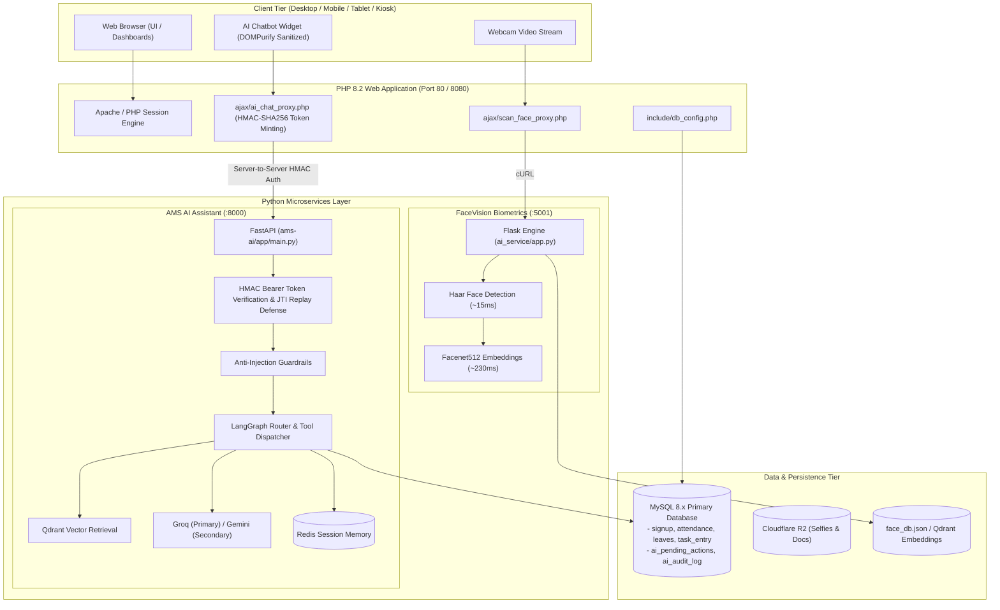

# 🏢 SETTribe Attendance Management System (AMS)
### *Enterprise Workforce & Productivity Management Platform with FaceVision Biometrics & Autonomous AI Assistant*

[](https://php.net)
[](https://fastapi.tiangolo.com)
[](https://www.docker.com)
[](https://python.org)
[](https://github.com/serengil/deepface)
[](https://langchain.ai)
[](https://mysql.com)
[](#)

---

## 📖 Executive Overview

**SETTribe AMS** is a unified, enterprise-grade **Workforce, Attendance, and Productivity Platform** engineered for IT organizations, high-efficiency corporate operations, and hybrid teams. It integrates daily operational workflows with two state-of-the-art AI subsystems:

1. **FaceVision AI Biometrics (`ai_service`)**: Real-time 4-stage facial verification (OpenCV Haar Cascade + DeepFace Facenet512) for 100% proxy-free biometric attendance, live webcam punch-in, and 3D motion enrollment.
2. **Autonomous AI Assistant (`ams-ai`)**: Conversational AI microservice (FastAPI + LangGraph + Groq/Gemini + Qdrant RAG + Redis) that answers employee attendance inquiries, inspects leave balances, logs daily task diaries, and answers company policy questions under a strict defense-in-depth security model.
3. **Operational Business Automation**: Automated late mark deductions, half-day shifts, early-go approvals, project task logging, and fiscal year leave resets.
4. **Modern Responsive UI System**: Glassmorphic realigned navbar, sticky pinned desktop sidebar with auto-route detection, dark/light themes, and offline QR badge support.

---

## 🏛️ Comprehensive Architecture



---

## 📁 Repository Structure

```text
Dev-SETTribe-AMS/
├── ajax/                      # AJAX endpoints & server-to-server proxies
│   ├── ai_chat_proxy.php      # Authenticated proxy to ams-ai microservice
│   ├── scan_face_proxy.php    # Proxy to FaceVision biometrics service
│   └── save_token.php         # FCM push notification token registrar
├── ams-ai/                    # [NEW] Autonomous Conversational AI Assistant
│   ├── app/                   # FastAPI application, agents, tools, guardrails
│   ├── tests/                 # Unit, security, and RBAC test suite (15 passing)
│   ├── requirements.txt       # Python dependencies
│   └── README.md              # Detailed ams-ai microservice documentation
├── ai_service/                # FaceVision AI Biometric Microservice
│   ├── app.py                 # Flask REST inference server (Port 5001)
│   ├── face_engine.py         # OpenCV Haar & DeepFace Facenet512 pipeline
│   ├── rebuild_db.py          # Vector cache indexer
│   └── README.md              # Detailed biometric microservice documentation
├── include/                   # Database configs, late mark engine, environment loaders
│   ├── db_config.php          # Main MySQL connection ($con, $conn aliases)
│   └── late_mark_helper.php   # Grace period & late mark business rules
├── migrations/                # Additive Database Migrations
│   ├── ai_tables_up.sql       # Up-migration (ai_pending_actions, ai_audit_log)
│   └── ai_tables_down.sql     # Down-migration (safe rollback)
├── pages/                     # Application views, dashboards, and workflows
│   ├── login.php              # Secure login portal
│   ├── live_face_attendance.php # Biometric webcam punch portal
│   ├── captureSelfie.php      # Mobile & web selfie punch-in
│   └── adminDashboard.php     # Administrative analytics hub
├── partials/                  # Shared UI components
│   ├── _navbar.php            # Glassmorphic top navigation with integrated AI chat
│   └── _sidebar.php           # Sticky pinned desktop navigation
├── composer.json              # PHP dependencies (PHPMailer, AWS SDK)
├── docker-compose.yml         # Multi-container deployment orchestrator
└── README.md                  # Master documentation (this file)
```

---

## 🚀 Quick Start Guide

You can run SETTribe AMS using **Docker Compose** or **Native Local Setup (XAMPP + Python)**.

---

### Option A: Docker Deployment (Recommended)

Requires **Docker Desktop**. Runs the web application and both AI microservices in isolated containers.

#### 1. Clone & Setup Configuration
```bash
git clone https://github.com/SETTribe-IT-Solutions/Dev-SETTribe-AMS.git
cd Dev-SETTribe-AMS
cp .env.example .env
```

#### 2. Run Database Migrations
Import [migrations/ai_tables_up.sql](file:///c:/xampp/htdocs/Dev-SETTribe-AMS-tusharsingh/migrations/ai_tables_up.sql) into your MySQL database:
```bash
mysql -u root -p nmrmlatur_settribe_ams < migrations/ai_tables_up.sql
```

#### 3. Build & Launch Containers
```bash
docker compose up --build -d
```

---

### Option B: Native Local Setup (XAMPP + Python)

#### 1. Web Application (XAMPP)
- Place project directory in `C:\xampp\htdocs\Dev-SETTribe-AMS-tusharsingh`.
- Start **Apache** and **MySQL** in the XAMPP Control Panel.
- Configure `.env` with your database credentials.

#### 2. Start Biometric Service (`ai_service` on Port 5001)
```bash
cd ai_service
pip install -r requirements.txt
python app.py
```

#### 3. Start AI Assistant Service (`ams-ai` on Port 8000)
```bash
cd ams-ai
pip install -r requirements.txt
python -m uvicorn app.main:app --host 127.0.0.1 --port 8000 --reload
```

#### 4. Run AI Assistant Tests
```bash
cd ams-ai
python -m pytest tests/ -v
```

---

## 🌐 Service Endpoints Reference

| Service | Protocol / Port | Local URL | Description |
| :--- | :---: | :--- | :--- |
| **AMS Web Portal** | HTTP / 80 | [http://localhost/Dev-SETTribe-AMS-tusharsingh/](http://localhost/Dev-SETTribe-AMS-tusharsingh/) | Primary employee & admin portal |
| **Login Page** | HTTP / 80 | [pages/login.php](http://localhost/Dev-SETTribe-AMS-tusharsingh/pages/login.php) | User authentication & role dispatch |
| **Live Face Attendance** | HTTP / 80 | [pages/live_face_attendance.php](http://localhost/Dev-SETTribe-AMS-tusharsingh/pages/live_face_attendance.php) | Automatic webcam facial punch |
| **FaceVision AI** | HTTP / 5001 | [http://localhost:5001/api/status](http://localhost:5001/api/status) | Biometric vector inference engine |
| **AMS AI Assistant** | HTTP / 8000 | [http://localhost:8000/api/health](http://localhost:8000/api/health) | Conversational agent microservice |

---

## 🛡️ Security & Zero-Trust Design Baseline

1. **No Client Spoofing**:
   - The browser connects solely to PHP endpoints (`ai_chat_proxy.php`).
   - PHP cryptographically signs identity tokens via HMAC-SHA256 with a 60-second time-to-live.
   - Any external attempts to send fake `X-User-Id` or spoof user roles are rejected.
2. **2-Step Parameter-Frozen Confirmation**:
   - Actions like applying for leaves or editing records require server-side 2-step confirmation.
   - Action parameters are cryptographically hashed and stored in `ai_pending_actions` with a 5-minute expiry.
3. **Feature Flags & Kill Switches**:
   - The AI Assistant is controlled via `AI_CHATBOT_ENABLED=true/false` in `.env`.
   - Role-level access is gated via `AI_CHATBOT_ALLOWED_ROLES=admin,hr,employee,intern`.
   - Disabling the flag restores the application to its standard state without any overhead.

---

## 🤝 Development & Branching Strategy

- **Primary Feature Branch**: `tusharsingh`
- **Code Integrity**: Strictly additive modifications to preserve 100% backward compatibility with existing attendance, leave, and biometric functions.

---

## 📄 Documentation Links
- [AMS AI Assistant Guide (`ams-ai/README.md`)](file:///c:/xampp/htdocs/Dev-SETTribe-AMS-tusharsingh/ams-ai/README.md)
- [FaceVision Biometrics Guide (`ai_service/README.md`)](file:///c:/xampp/htdocs/Dev-SETTribe-AMS-tusharsingh/ai_service/README.md)
- [Database Migrations (`migrations/ai_tables_up.sql`)](file:///c:/xampp/htdocs/Dev-SETTribe-AMS-tusharsingh/migrations/ai_tables_up.sql)

---

&copy; 2026 **SETTribe IT Solutions**. All rights reserved.  
*Internal enterprise software. Unauthorized distribution or copying is strictly prohibited.*
