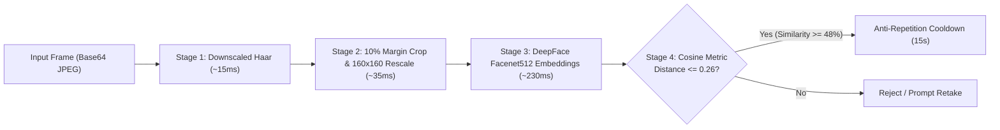

# 👁️ FaceVision AI Biometric Engine (`ai_service`)
### *High-Speed Facial Verification & 3D Motion Anti-Spoofing Service*

[](https://python.org)
[](https://github.com/serengil/deepface)
[](https://opencv.org)
[](https://flask.palletsprojects.com)

---

## 📖 Overview

The **FaceVision AI** biometric service is an optimized asynchronous Python microservice running on port **5001**. It powers the proxy-free biometric attendance workflows in SETTribe AMS by combining ultra-fast OpenCV Haar Cascade face detection with DeepFace Facenet512 feature representations.

---

## ⚡ The 4-Stage Verification Pipeline



1. **Stage 1: Downscaled Haar Face Detection (~15ms)**
   - Rescales incoming webcam stream to max 320px width before executing Haar cascade analysis, dropping detection overhead from ~270ms down to ~15ms.
2. **Stage 2: 10% Margin Cropping & Tensor Rescaling**
   - Automatically adds an outer 10% padding margin around detected face bounds and resizes directly to `(160, 160)` tensors, eliminating costly alignment steps.
3. **Stage 3: 512-Dimensional Vector Generation**
   - Extracts 512 floating-point values using `Facenet512` and normalizes using L2 norm.
4. **Stage 4: Cosine Distance & Session Locking**
   - Compares the generated vector against the employee's registered vector stored in `face_db.json`.
   - **Verification Threshold**: Cosine Distance $\le 0.26$ ($\ge 48.0\%$ similarity).
   - Enforces a 15-second per-employee cooldown in memory to eliminate accidental double punch-ins.

---

## 📡 REST API Reference

The service operates on `http://127.0.0.1:5001`:

| Endpoint | Method | Description |
| :--- | :---: | :--- |
| `/api/status` | `GET` | Microservice health, loaded model status, and total registered face count. |
| `/api/scan_face` | `POST` | Validates webcam snapshot against session user ID; returns verification score and commit status. |
| `/api/verify_and_register_face` | `POST` | Processes multi-angle face verification captures during enrollment. |
| `/api/enroll_face` | `POST` | Extracts facial embedding from uploaded employee profile photo and updates in-memory cache. |
| `/api/reload_cache` | `POST` | Force re-sync of all active employee facial vectors from MySQL database. |

---

## 🛠️ Maintenance & Database Rebuild

To rebuild or re-index the facial vector cache from employee profile photos:

```bash
cd ai_service
python rebuild_db.py
```
