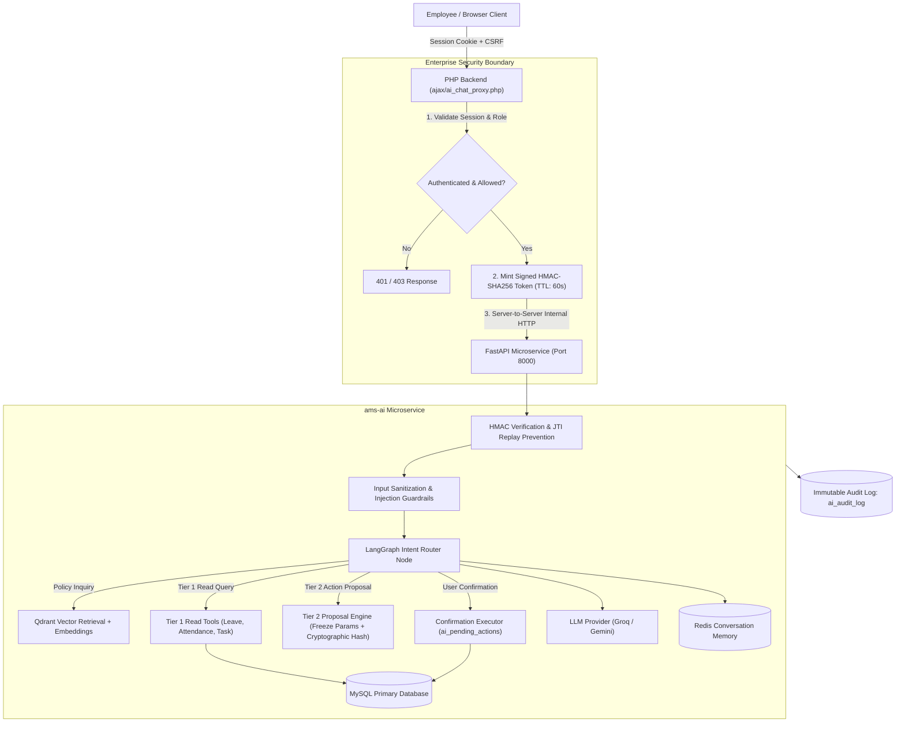

# 🤖 AMS AI Assistant Microservice (`ams-ai`)
### *Enterprise Autonomous Agent & Conversational AI Engine for SETTribe AMS*

[](https://python.org)
[](https://fastapi.tiangolo.com)
[](https://langchain.ai)
[](https://groq.com)
[](https://deepmind.google/technologies/gemini/)
[](https://qdrant.tech)
[](https://redis.io)

---

## 📖 Overview

The **AMS AI Assistant** is an asynchronous microservice providing a secure conversational AI interface for the SETTribe Attendance Management System (AMS). It empowers employees and managers to inquire about attendance records, query leave balances, manage daily task diaries, and consult official company policies through high-speed RAG (Retrieval-Augmented Generation).

---

## 🏛️ Architecture & Data Flow



---

## 🛡️ Security Architecture & Defense-in-Depth

The microservice strictly enforces an uncompromising security baseline:

1. **No Direct Client Exposure**:
   - The browser never makes direct network requests to `http://127.0.0.1:8000`.
   - All client traffic routes through the PHP server-side proxy [ajax/ai_chat_proxy.php](file:///c:/xampp/htdocs/Dev-SETTribe-AMS-tusharsingh/ajax/ai_chat_proxy.php).
2. **Cryptographic Identity Verification**:
   - PHP validates the real session (`$_SESSION['userId']`) and mints a short-lived (60s) HMAC-SHA256 token containing `sub`, `role`, `iat`, `exp`, and a unique `jti`.
   - FastAPI verifies the HMAC signature using `AI_INTERNAL_SECRET`. Replayed `jti` tokens or expired tokens are rejected immediately.
   - Client headers such as `X-User-Id` or `X-User-Role` sent from the browser are stripped and ignored; caller identity is bound solely to the signed cryptographic token.
3. **Strict 2-Step Parameter-Frozen Confirmation**:
   - Destructive or write actions (e.g. applying a leave) are never executed from single LLM prompts.
   - The system creates a pending action record in `ai_pending_actions` with a SHA-256 hash of frozen parameters and a 5-minute expiry.
   - A subsequent confirmation ("yes", "confirm") verifies the user ID, matching action, expiry, and single-use status before execution.
4. **Prompt Injection & Leakage Protection**:
   - Untrusted user inputs are scanned by [app/guardrails/detector.py](file:///c:/xampp/htdocs/Dev-SETTribe-AMS-tusharsingh/ams-ai/app/guardrails/detector.py) against prompt overrides, roleplay jailbreaks, and system prompt leakage attempts.
   - Database query parameters and policy documents are injected as strict data blocks, never evaluated as system instructions.
5. **Immutable Audit Logging**:
   - Every agent interaction is recorded in `ai_audit_log` with user ID, request ID, intent, execution latency, and completion status.

---

## 🧩 Supported Operations & Tiers

| Tier | Category | Available Tools | Status |
| :--- | :--- | :--- | :---: |
| **Tier 1** | **Read-Only** | - `get_leave_balance`: Check Casual, Medical, Maternity/Paternity leave quotas.<br>- `get_attendance_history`: Inquire daily punch-in, punch-out, late marks, and working hours.<br>- `get_task_diary`: View logged project tasks, durations, and entries.<br>- `policy_qa`: Ask questions about company policies, leave guidelines, and office rules (via Qdrant RAG). | ✅ Active |
| **Tier 2** | **Safe Writes (Own Data Only)** | - `apply_leave`: Propose and execute leave requests (requires 2-step confirmation).<br>- `cancel_leave`: Cancel pending unapproved leave applications.<br>- `log_task`: Add task entries to daily work diary. | ✅ Active (Guarded) |
| **Tier 3** | **High-Risk Operations** | Punch in/out (requires physical camera + geolocation), manager leave approvals/rejections, resource allocations. | ⛔ Intentionally Deferred |

---

## 🗄️ Database Tables (`migrations/`)

The AI assistant relies on two additive database tables (defined in [migrations/ai_tables_up.sql](file:///c:/xampp/htdocs/Dev-SETTribe-AMS-tusharsingh/migrations/ai_tables_up.sql)):

### 1. `ai_pending_actions`
Stores stateful action proposals awaiting explicit user confirmation:
- `confirmation_id` (VARCHAR 64, PK): Unique token for the pending transaction.
- `user_id` (VARCHAR 225): Cryptographically bound owner.
- `action_name` (VARCHAR 100): Tool name to execute (e.g., `apply_leave`).
- `params_hash` (VARCHAR 64): SHA-256 hash of frozen arguments.
- `params_json` (TEXT): Serialized argument payload.
- `expires_at` (DATETIME): Expiration timestamp (default 5 minutes).
- `is_used` (TINYINT 1): Prevent double-spend / replay.

### 2. `ai_audit_log`
Immutable security and performance audit trail:
- `id` (BIGINT, PK): Incremental log identifier.
- `request_id` (VARCHAR 64): Unique correlation ID across PHP and Python.
- `user_id` (VARCHAR 225) & `user_role` (VARCHAR 50): User context.
- `intent` (VARCHAR 100) & `tool_name` (VARCHAR 100): Routing telemetry.
- `status` (VARCHAR 20): `SUCCESS`, `DENIED`, `REJECTED`, or `ERROR`.
- `execution_time_ms` (INT): Total round-trip inference latency.

---

## 🚀 Setup & Local Execution

### Prerequisites
- Python 3.10, 3.11, or 3.12
- MySQL 8.x database with AMS schema loaded
- Redis (optional for development memory, fallback to local memory)
- Qdrant (optional for vector search)

### 1. Install Dependencies
```bash
cd ams-ai
python -m venv venv
# Windows:
venv\Scripts\activate
# Linux/macOS:
source venv/bin/activate

pip install -r requirements.txt
```

### 2. Configure Environment (`.env`)
Create `.env` inside `ams-ai/` or configure the root `.env`:
```ini
ENVIRONMENT=development
PORT=8000
HOST=127.0.0.1

# AI Server Security Secret (Must match PHP config)
AI_INTERNAL_SECRET=your_32_byte_secret_hex_here

# LLM Providers
LLM_PROVIDER=groq
GROQ_API_KEY=gsk_your_groq_api_key
GROQ_MODEL=openai/gpt-oss-120b
GEMINI_API_KEY=your_gemini_api_key

# Database Connection
MYSQL_HOST=127.0.0.1
MYSQL_PORT=3306
MYSQL_DATABASE=nmrmlatur_settribe_ams
MYSQL_USER=root
MYSQL_PASSWORD=

# Vector Search & Memory
QDRANT_URL=http://localhost:6333
QDRANT_API_KEY=
REDIS_URL=redis://localhost:6379/0
```

### 3. Run Database Migrations
Execute [migrations/ai_tables_up.sql](file:///c:/xampp/htdocs/Dev-SETTribe-AMS-tusharsingh/migrations/ai_tables_up.sql) in phpMyAdmin or MySQL CLI:
```bash
mysql -u root -p nmrmlatur_settribe_ams < ../migrations/ai_tables_up.sql
```

### 4. Start the Service
```bash
python -m uvicorn app.main:app --host 127.0.0.1 --port 8000 --reload
```

---

## 🧪 Running the Test Suite

The test suite validates unit logic, role-based access control, cryptographic HMAC verification, replay defense, and anti-jailbreak guardrails:

```bash
cd ams-ai
python -m pytest tests/ -v
```

### Verification Coverage
- **`tests/test_guardrails.py`**: Validates prompt injection filtering, roleplay detection, and system prompt leakage blocking.
- **`tests/test_security.py`**: Validates missing bearer token denial, expired token rejection, invalid signature blocking, and header spoofing rejection.
- **`tests/test_unit.py`**: Validates parameter hash generation, date normalization, intent routing, and tool schemas.

---

## 📡 API Specification

### 1. `POST /api/v1/chat`
Handles conversational user queries.
- **Authentication**: `Authorization: Bearer <HMAC_TOKEN>`
- **Request Body**:
  ```json
  {
    "message": "What is my casual leave balance?",
    "session_id": "sess_abc123"
  }
  ```
- **Response**:
  ```json
  {
    "response": "You currently have 5 days of Casual Leave remaining for this financial year.",
    "session_id": "sess_abc123",
    "intent": "leave_balance",
    "requires_confirmation": false
  }
  ```

### 2. `GET /api/health`
Detailed service health status (DB connectivity, memory, vector store).
- **Response**: `{"status": "ok", "service": "ams-ai", "database": "connected"}`

### 3. `GET /api/health/live`
Lightweight Kubernetes / Docker liveness probe.
- **Response**: `{"status": "alive"}`
